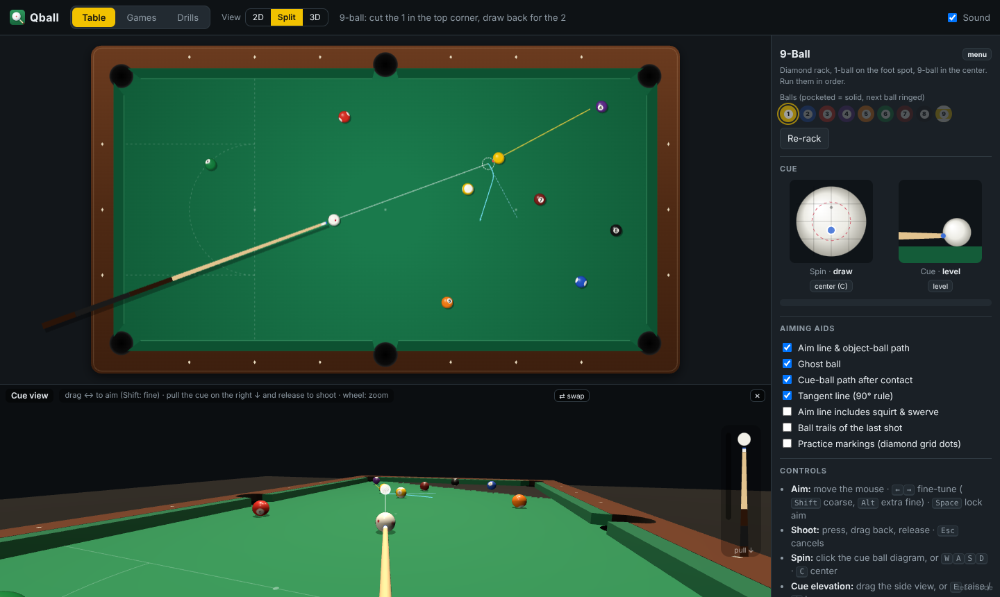

<p align="center"></p>

<h1 align="center">Qball</h1>

<p align="center"><b>A realistic billiards (pool) simulator in the browser, for playing and practicing.</b><br>
Real ball physics (sliding, rolling, spin, squirt, throw, cushions), 9- and 10-ball, drills, and a 3D cue's-eye view.</p>



## Quick start

No install, no build, no server. Plain HTML + JavaScript.

```bash
git clone https://github.com/afaisst/Qball.git
cd Qball
open index.html        # or double-click index.html (macOS); any modern browser works
```

Everything runs offline. The only library, [three.js](https://threejs.org) (r149, for the 3D view), is vendored in `js/vendor/`.

To host it, any static web host works. For example, turn on **GitHub Pages** (Settings → Pages → *Deploy from branch* → `main` / root) and the game is at `https://afaisst.github.io/Qball/`.

## Features

- **Physics, not animation:** every ball carries a velocity and a spin vector. Sliding and rolling friction, side-spin decay, cue-tip contact with miscues, squirt (cue deflection), swerve/massé with an elevated cue, ball–ball throw, and a research-based cushion model ([Mathavan et al. 2010](#references)). See [Physics model](#physics-model).
- **Spin and elevation:** pick the tip contact point on a cue-ball diagram and raise the cue butt on a side view. Hitting outside the dashed ring is a miscue.
- **Rail clearance:** within 20 cm of a cushion, the cue has to pass over the rail. The part of the cue ball you can't reach is shaded red, and raising the cue shrinks it. When the cue lies over a pocket, there's no cushion under it, so the obstacle is the rail behind the hole: farther back, which frees up draw shots.
- **Games:** 8-, 9- and 10-ball racks plus free practice. 9-ball and 10-ball use (simplified) foul rules with ball in hand.
- **Lessons:** step-by-step introductions with explanations (Lesson 1: the stop shot).
- **Drills:** Billiard University–style target drills with level progression and scoring, and pattern drills (L-drill, line-ups, rail balls, diamond grid, Dr. Dave's 3-ball drill, random layouts, play the ghost).
- **Free ball placement:** build any position from all 15 balls.
- **Views:** 2D top view, a 3D cue's-eye view, or both (split). The 3D view has drag-to-aim, a pull-back cue to shoot, zoom from "down on the shot" to standing, and a **walk mode** to look at the layout from around the table. Balls have a satin finish with light wear (faint chalk marks and scuffs), the cloth has a felt texture with a faint nap and light wear along the break lane, the cushions have a real profile (rounded nose, face slanting back under it, curved jaws at the pockets), the rails are grained wood, and the table stands on six turned legs on a patterned rug in a wood-panelled room with paintings by Swiss artists in gilded frames and a door left slightly ajar, lit by a three-shade billiard lamp whose spotlights give each ball its soft shadows (all textures are generated in the browser, `js/textures.js`). Pocketed balls don't just vanish: they drop into the pocket, rattle off its wall (a slow ball circles the rim), bounce on the bottom and settle in the pocket (several balls stack up in the same pocket). They stay there until they are re-spotted or re-racked (a visual animation; the physics and rules count the ball as pocketed the moment its centre crosses the drop line). After a shot the 3D camera pulls back to an overview of the whole table while the balls roll, then returns to your aiming view (can be turned off in Settings).
- **Settings** (⚙ in the top bar; remembered): realistic shadows from the three lamps (or one light from above), the post-shot overview, and **aiming aids** (each can be turned off): aim line, ghost ball, a red cross on the cue ball where the tip will hit (3D), an **eclipse view** (a small inset looking exactly along the cue line: the cue ball's outline over the object ball shows the ball fraction, e.g. 50% for a half-ball hit), object-ball path, cue-ball path (after hitting a ball or a cushion), tangent line, ball trails, practice markings.
- **Test mode** for physics experiments: exact inputs, sliders for every physics parameter, shot reports, replay, slow motion, and copy/paste of complete shots as JSON.

## How to play

### Table size

Choose a **9 ft** (tournament, 100" × 50" playing surface; the default), **8 ft** (home table, 88" × 44") or **7 ft** (bar box, 78" × 39") table in the top bar. The choice is remembered; the page reloads and builds everything — table, pockets, markings, drills, lessons and the 3D room — at that size. Pockets and balls keep their regulation sizes.

### Shooting (top view)

| Action | How |
|---|---|
| Aim | Move the mouse. **Click** on the table to freeze the aim, so you can go to the panel without losing it; click again to release (a shot also releases it). <kbd>←</kbd> <kbd>→</kbd> fine-tune (<kbd>Shift</kbd> coarse, <kbd>Alt</kbd> extra fine). <kbd>Space</kbd> locks the aim. |
| Shoot | Press anywhere on the table, drag back to pull the cue, release. <kbd>Esc</kbd> cancels. |
| Spin | Click/drag on the cue-ball diagram, or <kbd>W</kbd> <kbd>A</kbd> <kbd>S</kbd> <kbd>D</kbd>. <kbd>C</kbd> or double-click centers it. |
| Cue elevation | Drag the side-view diagram, or <kbd>E</kbd> raise / <kbd>Q</kbd> lower. Double-click for a level cue. |
| Ball in hand | Drag the cue ball where you want it. |
| View | 2D / Split / 3D in the top bar. <kbd>V</kbd> cycles; the choice is remembered. |
| Test mode | The small *test mode* link at the bottom right, or <kbd>T</kbd>. |
| Help | **? Help** in the top bar (or <kbd>?</kbd>) shows all the controls. |

### Touch screens (iPad, tablets)

Touch is detected automatically. With a mouse, the **👆 Touch mode** button in the top bar turns on the same controls (the button is hidden on touch-only devices, where they're always on). There's no hover on a touch screen, so:

- **Aim:** drag a finger anywhere on the table and the cue points toward it. For fine aiming, start the drag on the cue ball and move sideways; 1 cm of finger motion turns the cue by about 0.1°.
- **Shoot:** in the 2D view a pull-down cue appears on the right (the same one the 3D view has). Drag it down and let go.
- **3D view:** drag to aim, pinch to zoom. Double-tap the map to return to your shot.
- **Spin and elevation:** tap or drag on the diagrams; use the *center* and *level* buttons to reset.
- In portrait orientation the panel moves below the table. On a phone (or any tall, narrow view) the 2D table is drawn upright, with the head rail at the bottom, whenever that makes it bigger; the top bar wraps onto two lines.

### 3D cue view

- **Aim:** drag left/right (<kbd>Shift</kbd> for fine steps). The 3D view doesn't follow the mouse.
- **Shoot:** drag the little cue on the right side down to pull back, then release.
- **Zoom:** mouse wheel. Zooming in gets you down on the shot (eye just above the cue); zooming out stands you up. When you raise the cue, the view backs off automatically so the whole stick stays visible.
- **Map:** in 3D-only view, a small top-view map appears for ball in hand and arranging balls; the big **🗺 Map** button in the right panel shows it any time. It sits in the lower left; drag it anywhere by the ✥ grip in its corner (double-click the grip to put it back).
- **Walk mode:** press the big **🚶 Walk** button in the right panel, or keep zooming out after you're standing, to stand up where you are. Everything is steered from the map: drag the blue dot to move (or click where to go; you walk around the table, not through it) and drag the blue view cone to turn (the view turns at the same up/down angle), or double-click (double-tap) anything in the 3D view — a ball, a spot on the cloth, a painting or a spot on the wall — to look at it; a ball in front hides the ones behind it. Double-clicking in the 3D view from your shot stands you up into walk mode looking there. The spot you look at is shown as a ring on the map and stays fixed: as you walk you keep facing it. You can also drag the crosshair itself, e.g. onto a ball (it snaps to the ball), to keep looking at that ball while you walk around it. The wheel (or a pinch) on the 3D view bends you down toward the table. The cue walks with you: while walking you carry it (shown see-through, along your line of sight; on the map through the blue dot), and when you return to your shot (press walk again, double-click the map, or pick up the cue) you aim in that direction, with the zoom you had before.

### Lessons

Step-by-step introductions (the **Lessons** tab). Each lesson sets the balls up for you and limits what you can change, so it is about one thing at a time. Short pop-ups explain each step, the panel shows a strength meter (soft / medium / hard) and the result of every shot, and the balls are set up again after each shot. *Show the instructions* brings the current step's text back.

- **Lesson 1 · The stop shot:** a straight shot into the side pocket with the aim fixed; you choose the strength and how low you hit the cue ball (on the vertical line through its centre, at or below it).
  1. *Center ball*, soft / medium / hard: soft follows, medium and hard stop (a sliding cue ball stops, a rolling one follows).
  2. *A little below center* (green marker): soft follows much less, medium stops dead, hard draws back.

New lessons are defined in `js/lessons.js` (balls, limits, strength bands, steps and texts).

### Games

- **9-ball / 10-ball (solo practice, simplified WPA rules):** hit the lowest-numbered ball first, and after contact pocket a ball or drive any ball to a rail. A scratch is a foul too. Any foul gives ball in hand anywhere, and a game ball pocketed on a foul is re-spotted. Legally pocketing the 9 (or 10) wins the rack. Not yet included: break requirements, call shots, the three-foul rule, push-out.
- **8-ball:** the rack with ball in hand for the break (no 8-ball rules yet).
- **Free practice:** the cue ball and the 1-ball.

The panel shows the rack: balls still on the table are faded, pocketed ones are solid, and the next ball is ringed.

### Drills

- **Target drills** (inspired by the Billiard University Exam I: cut shots, stop, follow, draw, stun, wagon wheel): you start at level 4. A make moves you up a level and a miss moves you down. After 10 shots, the score is the final level plus makes at the top level. The target pocket pulses yellow, and cue-ball targets are cyan circles.
- **Pattern drills:** take ball in hand, then run the balls. Every shot must pocket a ball, and a miss or scratch ends the try. You get 10 tries. Drills: L-drill, diamond grid, long line-up, cross line, balls on the rails, Dr. Dave's 3-ball drill, random layouts, play the ghost.
- **Free Ball Placement:** drag any of the 15 balls onto the table. *Arrange* (<kbd>M</kbd>) moves balls; dragging a ball off the table or double-clicking it removes it. *↺ Last setup* restores the position before the last shot.

Draw shots and raised-cue shots leave a small chalk mark on the cloth, like on a real table.

### Test mode

- Drag any ball (<kbd>Shift</kbd> or *Move balls*), or type exact positions in meters.
- **Shoot precisely:** aim angle, cue speed (m/s), tip offset, elevation, or an exact cut angle (*Set cut*). <kbd>Enter</kbd> shoots, <kbd>R</kbd> replays the identical shot, <kbd>X</kbd> stops all balls.
- **Physics sliders** for every parameter below, plus a choice of cushion model.
- **Shot report** (cut angle, departure angles, speeds), live ball state (sliding/rolling, ω), trails, contact positions, full-physics path preview, and slow motion.
- **Share a shot:** *Copy last shot* puts the full shot on the clipboard as JSON: positions, aim, speed, tip, elevation and all physics settings. *Load shot…* sets it up again, and `node test/replay_shot.js shot.json` replays it in the terminal.

## Physics model

`js/physics.js`. SI units, origin at the table center, +x toward the foot rail, +y toward the top rail.

| Quantity | Default |
|---|---|
| Table | 9 ft, 2.54 × 1.27 m playing surface |
| Pockets | corner mouth 4.5″, side 5″, jaw angles 142° / 104° |
| Ball | R = 28.575 mm, m = 0.17 kg |
| Sliding friction μs | 0.11 |
| Rolling resistance μr | 0.0155 |
| Side-spin decay | 20 rad/s² |
| Ball–ball restitution | 0.975 |
| Ball–ball friction | μ = 0.00995 + 0.108·e^(−1.088·slip) (measured curve) |
| Cushion model | Mathavan 2010 (alternatives: Han 2005, simple) |
| Cushion restitution / friction | e = 0.85 (−0.018 per m/s), μc = 0.25, nose at 63.5% of ball height |
| Cue | 0.54 kg, end mass 3 g (squirt), tip friction 0.66, max speed 6 m/s, elevation 0–80° |
| Timestep | 0.2 ms, with exact rewind to each collision |

The defaults were tuned by feel against real shots (e.g. 3-rail and kick shots) and can all be changed in test mode.

**Ball motion.** Each ball has linear velocity **v** and angular velocity **ω**. The slip of the contact point on the cloth decides the phase:

- **Sliding:** friction μs·g opposes the slip. A center-ball hit turns into rolling at 5/7 of its initial speed.
- **Rolling:** rolling resistance μr·g, with spin locked to the velocity.
- **Side spin** decays at a constant rate.

Each phase has constant acceleration, so it is integrated analytically, and phase changes happen at the exact time.

**Cue strike.** The pull-back sets the cue speed V. The tip hits the ball at the chosen offset (a, b) on a cue tilted by elevation θ. The impulse magnitude is

`F = (1+e)·V·(ê·k) / ((ê·k)²/M + 1/m + |OP×k|²/I)`

which reduces to Alciatore's TP A.30 for a level cue. This gives speed and all three spin components, so an elevated cue with english produces **swerve and massé**. If the contact angle exceeds the tip friction limit, the shot is a **miscue**: the tip slides, and you get a weak, off-line, nearly spinless hit. **Squirt** comes from the shaft's effective end mass (TP A.31).

**Ball–ball collisions.** A normal impulse with restitution, plus friction at the contact. Friction uses the measured μ(slip) curve and the spins of both balls. This produces cut-induced throw (≈3.5° for a slow 30° stun cut, <1° when fast) and spin-induced throw, and transfers a little spin to the object ball.

**Cushions** (selectable):

- **Mathavan 2010** (default): the impact is integrated through compression and restitution. Friction acts both at the cushion nose and at the slate, where the cushion presses the ball into the cloth. Topspin, slide and running/reverse english all shape the rebound.
- **Han 2005:** a single impulse at the cushion nose with restitution and friction.
- **Simple:** reflect the normal velocity and keep rolling. Not physical; kept for comparison.

**Pockets:** the jaws are real line segments (balls can rattle). A ball drops when its center enters the pocket's drop circle.

## Tests

```bash
node test/physics_test.js      # rolling speed 5/7, slide/roll distances, 30°/90° rules, cushion, pockets,
                               # stop/draw/follow, english off the rail, squirt, throw, massé, miscues
node test/compare_cushions.js  # compares the cushion models
node test/replay_shot.js shot.json [param=value …]   # replays a copied shot, listing every contact
```

The tests need [Node.js](https://nodejs.org) and print measured values next to the theoretical ones.

## Project structure

```
index.html          page layout
css/style.css       styles
js/constants.js     table, ball, cue dimensions and physics defaults
js/table.js         table geometry: cushions, pocket jaws, diamonds, spots
js/physics.js       ball motion, collisions, cushion models, cue impact
js/render.js        2D top view (canvas)
js/view3d.js        3D cue view and walk mode (three.js)
js/textures.js      procedural cloth, felt, wood, rug, floor and wallpaper textures
js/art.js           the paintings (generated by tools/embed-art.js from assets/art/)
tools/embed-art.js  packs assets/art/*.jpg into js/art.js
js/setups.js        game racks and drill definitions
js/lessons.js       lessons: setups, limits, steps and texts
js/audio.js         sounds (Web Audio, generated)
js/main.js          input, game and drill logic, UI
js/vendor/          three.js r149 (MIT license)
test/               command-line physics tests (Node.js)
assets/             icon and screenshot
```

## Roadmap

- 8-ball rules and a two-player mode (turns, fouls, groups, called shots)
- Break rules for 9/10-ball, push-out, three-foul rule
- Jump shots (vertical ball motion) and the table-friction impulse during elevated hits
- More drills

## References

- D. G. Alciatore, *The Illustrated Principles of Pool and Billiards* and his technical proofs at [drdavepoolinfo.com](https://drdavepoolinfo.com) (cue–ball impact TP A.30, squirt TP A.31, throw).
- S. Mathavan, M. R. Jackson, R. M. Parkin, "A theoretical analysis of billiard ball dynamics under cushion impacts," *Proc. IMechE Part C* 224 (2010).
- H. Han, "Dynamics in carom and three cushion billiards," *J. Mech. Sci. Technol.* 19 (2005).
- Drills inspired by the [Billiard University](https://billiarduniversity.org/) exams and [Dr. Dave's drill pages](https://drdavepoolinfo.com/). Ball positions are approximations, not the official diagrams.

## Art in the 3D room

The paintings are packed into `js/art.js` by `node tools/embed-art.js` from `assets/art/` (images + `paintings.json`).

- **Public domain** (via Wikimedia Commons): Ferdinand Hodler, *Lake Thun with Symmetrical Reflection* (1905), *The Niesen* (1910) and *Lake Geneva from Chexbres* (1905); Albert Anker, *The Village School of 1848* (1896); Arnold Böcklin, *Isle of the Dead* (first version, 1880); Félix Vallotton, *Sunset at Grasse* (1918); Giovanni Giacometti, *Maloja in Winter*; Paul Klee, *Senecio* (1922).
- **Rainer Oberhänsli**, two *Horizont* paintings — © the artist, used with his permission ([raineroberhaensli.ch](http://www.raineroberhaensli.ch/galerie.htm)). These are not covered by this project's licence and may not be reused without the artist's permission.

## Credits

Created by Andreas Faisst. The 3D view uses [three.js](https://threejs.org) (MIT license, see `js/vendor/three.LICENSE.txt`).
