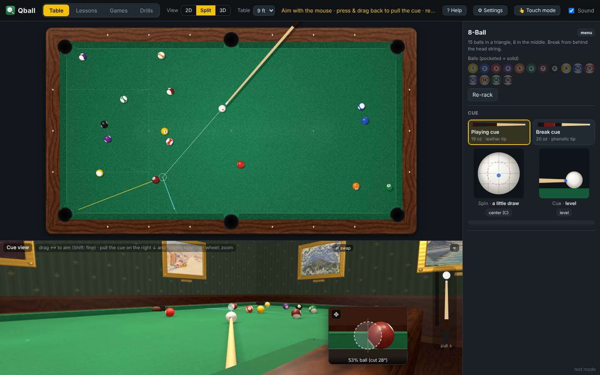
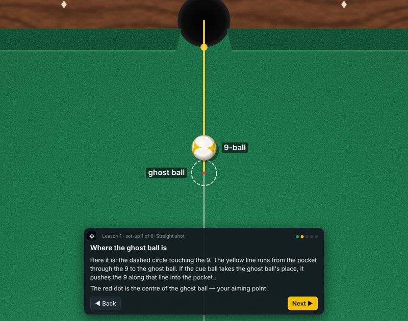
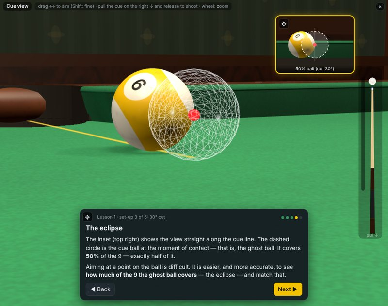
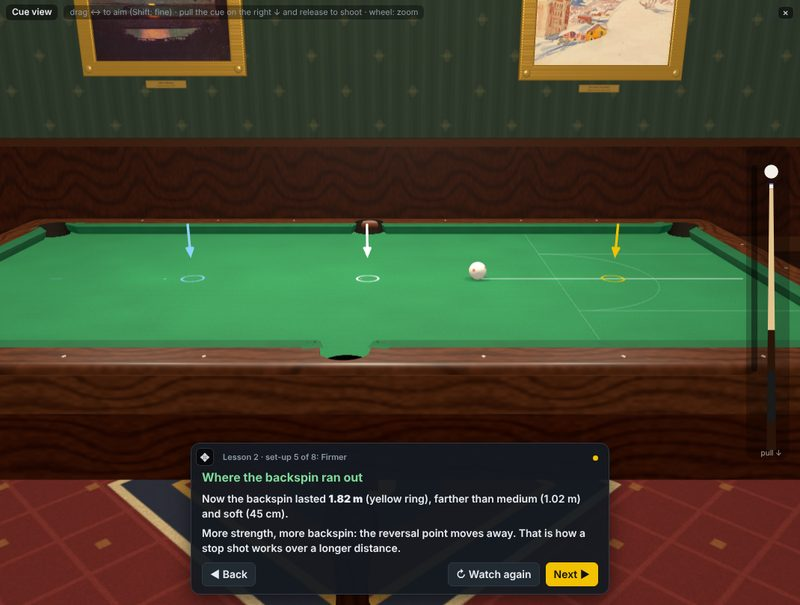
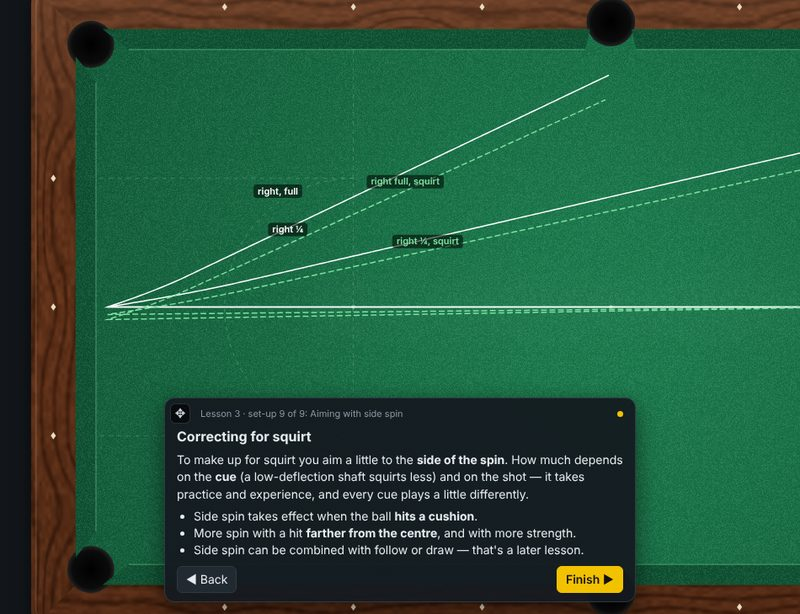
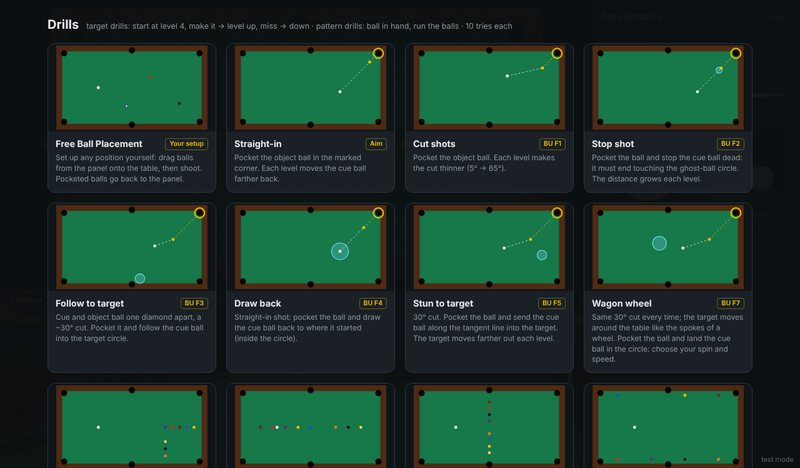
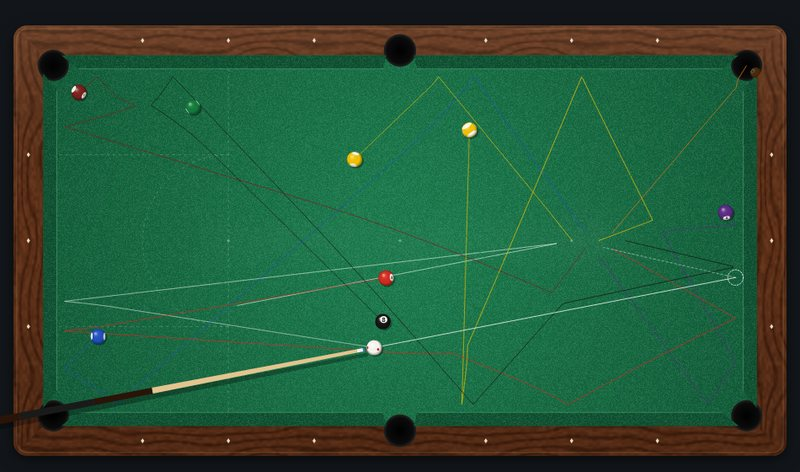
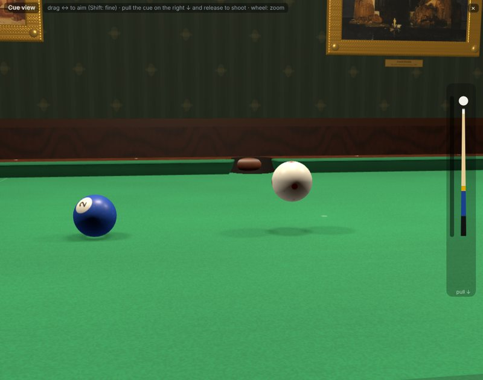
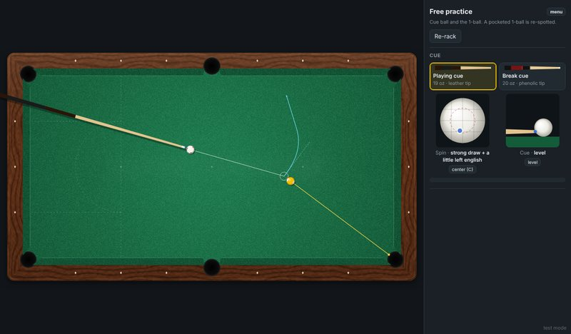
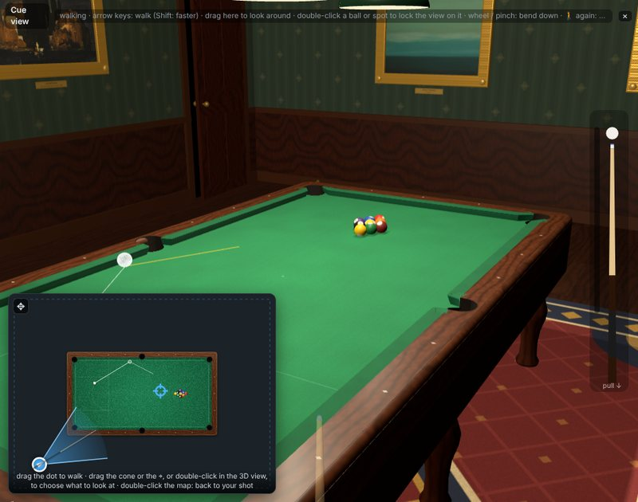

<p align="center"></p>

<h1 align="center">Qball</h1>

<p align="center"><b>A pool (billiards) simulator that knows the physics — for playing, practicing and learning.</b></p>

<p align="center"><a href="https://afaisst.github.io/Qball/play.html"><b>▶ Play Qball in your browser</b></a><br>
<sub>No install, no account. Works with a mouse, on a tablet, and offline (see <a href="#play-offline">Play offline</a>).</sub><br>
<sub>The same guide as a web page: <a href="https://afaisst.github.io/Qball/">afaisst.github.io/Qball</a> (also the 📖 Documentation button in the game).</sub></p>



## Why Qball?

Most pool games animate the balls. **Qball simulates them.** Every ball carries a velocity *and* a spin, and everything you see follows from the physics of a real table:

- **Spin from the cue tip.** Where the tip meets the cue ball, how hard, and how steep the cue is decide the ball's speed and all three components of its spin. That gives you follow, draw, stun and side spin (english) — and, with a raised cue, **swerve and massé**. Hit too far from the centre and you **miscue**.
- **Sliding, then rolling.** A ball first slides over the cloth; friction turns the slide into roll (at 5/7 of the starting speed for a centre-ball hit). That is why a stop shot needs a sliding cue ball, and why a soft centre-ball hit follows.
- **Squirt.** Side spin pushes the cue ball slightly off the line you aim (cue deflection), just as with a real shaft.
- **Throw.** Friction between the balls bends the object ball's path a little: cut-induced throw (up to ~3.5° on a slow cut) and spin-induced throw, from a measured friction curve.
- **Real cushions.** The rebound uses a research model of the cushion impact (Mathavan et al. 2010), with friction at the cushion and at the slate. Running and reverse english change the angle off the rail, and a hard hit "shortens" the angle.
- **Real pockets.** The pocket jaws are modelled, so balls can rattle and hang. Pocketed balls drop in, roll around the pocket and stay there until you re-rack.
- **Real breaks.** In a rack the balls touch, so all the contacts act at once. Qball solves them together with an elastic contact model, so the break spreads through the rack the way it does on a real table — and a frozen combination passes its speed on to the far ball.
- **Jump shots.** With a raised cue the cue ball is driven into the slate, which throws it back up. A short, light jump cue gets out of the way and the ball flies over the ball in its path; a heavy cue held too steep hits it again and pins it to the cloth. In the air the ball follows a real trajectory, bounces when it lands, can hit a ball on the way down — and can leave the table: then it drops to the floor, bounces off the walls (leaving a dent if it hits hard) and rolls away.
- **Rail clearance.** Near a cushion the cue has to clear the rail: you can't hit the cue ball as low, unless you raise the cue.

The simulation has been **tested by a pool expert** against real shots — draw, follow, cuts, kicks and three-rail shots — and its settings were tuned until the table played like a real one.

## Learn: lessons

The **Lessons** tab teaches one idea at a time. The balls are set up for you, only the thing the lesson is about can be changed, and a lesson card on the table explains each step while the views move to show it.

<table><tr>
<td width="50%"></td>
<td width="50%"></td>
</tr><tr>
<td><sub>Lesson 1: where the ghost ball is.</sub></td>
<td><sub>Lesson 1: a 30° cut seen along the cue line. You aim at the edge of the 9 — a half-ball hit.</sub></td>
</tr><tr>
<td width="50%"></td>
<td width="50%"></td>
</tr><tr>
<td><sub>Lesson 2: where the backspin runs out — soft, medium and firm.</sub></td>
<td><sub>Lesson 3: right spin off the cushion, without and with squirt.</sub></td>
</tr></table>

- **Lesson 1 · Aiming with the ghost ball.** Where do you aim? At the *ghost ball*: the spot the cue ball has to take, touching the object ball on the line to the pocket. You see it from above, from behind the pocket and from the cue ball, in a straight shot and in 10°, 30° and 50° cuts. The aiming point moves from the centre of the object ball to its edge (30°, the half-ball hit) and into the air beside it (50°), and the **eclipse view** shows the easier way to aim: how much of the object ball the cue ball covers. Then you place the ghost ball yourself, aim and shoot, and Qball shows how far off you were.
- **Lesson 2 · Follow and draw.** Where to hit the cue ball for **follow** and **draw**, named by the clock on the cue-ball picture. The aim is set; you choose the hitting point and pull the cue into a blue band that shows the right strength. Each draw shot is replayed in slow motion from the side, and a ring marks where the backspin runs out — the spot where a stop shot would happen. Softer, firmer and nearer the centre move that spot; a firm centre-ball hit makes the ball slide without spin.
- **Lesson 3 · Side spin.** **Side spin** at 3 and 9 o'clock: it does nothing on the cloth and changes the angle off the cushion. Shots straight into the rail with a little and a lot of spin, to the right and to the left, replayed from above with their paths drawn. Then **squirt** is switched on, and you see the cue ball leave the aiming line — more the farther off-centre you hit.
- **Lesson 4 · The stop shot.** The straight **stop shot**. Hit the stop-shot point and the cue ball stops dead; then hit lower and higher, softer and firmer, watch the slow-motion replay and say what happened (stop, draw or follow). Finally, with the cue ball 5 cm farther back, you choose the hitting point and the strength yourself and have to stop it in a small circle — and see that a firm centre-ball hit works too at short range.

More lessons are on the way.

## Practice: drills

The **Drills** tab has practice routines you can also set up on a real table — each card shows the layout.

<p align="center"></p>

- **Target drills** (inspired by the Billiard University exam): straight-in, cut shots, stop shot, follow, draw, stun to a target and the wagon wheel. You start at level 4; a make moves you up a level, a miss moves you down. After 10 shots you get a score out of 10.
- **Pattern drills:** ball in hand, then run the balls without missing — the L-drill, a long line-up, a cross line, balls frozen to the rails, the diamond grid, Dr. Dave's 3-ball drill, random layouts and "play the ghost". Ten tries each.
- **Free ball placement:** put any of the 15 balls anywhere and practise the shot that's been giving you trouble.

## Play: 8-ball, 9-ball, 10-ball

<table><tr>
<td width="50%"></td>
<td width="50%"></td>
</tr><tr>
<td><sub>A break with the break cue (ball trails on).</sub></td>
<td><sub>A jump shot with the jump cue, watched from the side in slow motion.</sub></td>
</tr></table>

- **9-ball and 10-ball** with the main rules for solo practice: hit the lowest ball first, and after contact pocket a ball or send one to a rail. Fouls give ball in hand; pocketing the 9 (or the 10) wins the rack.
- **8-ball:** the rack and the break (the full 8-ball rules are on the roadmap).
- **Free practice:** the cue ball and one object ball, re-spotted after each pot.
- **Break cue:** for the break, take the break cue from the cue rack (or press <kbd>B</kbd>). Its hard phenolic tip and an all-out stroke send the cue ball at up to ~13 m/s (about 30 mph), like a strong pro break. After the break you get your playing cue back.
- **Jump cue:** a ball in the way? Take the short jump cue (or press <kbd>J</kbd>). It starts raised to 50°: hit the cue ball firmly in the centre and it jumps over. Too soft, too steep or off centre and it stays on the cloth; too hard and it may fly off the table — a foul, ball in hand. The ball drops to the floor and rolls away; hit the wall hard and it leaves a dent (or cracks a painting's glass). **⚙ Settings → Repair the room** fixes it all.

## How to play

### Shooting (mouse)

| Action | How |
|---|---|
| Aim | Move the mouse. **Click** to freeze the aim (so you can go to the panel), click again to release. <kbd>←</kbd> <kbd>→</kbd> fine-tune (<kbd>Shift</kbd> coarse, <kbd>Alt</kbd> extra fine). <kbd>Space</kbd> locks the aim. |
| Shoot | Press on the table, drag back to pull the cue, let go. The farther you pull, the harder the shot. <kbd>Esc</kbd> cancels. |
| Spin | Click or drag on the cue-ball picture, or <kbd>W</kbd> <kbd>A</kbd> <kbd>S</kbd> <kbd>D</kbd>. <kbd>C</kbd> centres it. Outside the dashed ring you miscue. |
| Cue elevation | Drag the side-view picture, or <kbd>E</kbd> raise / <kbd>Q</kbd> lower. |
| Cue | Playing cue, break cue or jump cue in the cue rack; <kbd>B</kbd> break cue, <kbd>J</kbd> jump cue (again: back to the playing cue). |
| Ball in hand | Drag the cue ball where you want it. |
| View | **2D**, **Split** or **3D** in the top bar; <kbd>V</kbd> cycles. |
| Help | **? Help** (or <kbd>?</kbd>) lists all the controls; **📖 Documentation** opens the illustrated guide. |

<table><tr>
<td width="50%"></td>
<td width="50%"></td>
</tr><tr>
<td><sub>Spin: tip low and a little left. The light-blue line shows where the cue ball goes after the hit.</sub></td>
<td><sub>Walk mode: look at the layout from anywhere around the table.</sub></td>
</tr></table>

### The 3D view

The 3D view is your eye down the cue, in a billiard room with a three-shade lamp and paintings on the walls.

- **Aim:** drag left or right (<kbd>Shift</kbd> for fine steps). **Shoot:** pull the little cue on the right side down and let go.
- **Zoom:** the mouse wheel takes you from down on the shot to standing up. Keep zooming out to start walking.
- **After the shot** the camera pulls back so you can watch the whole table, then returns to your shot. A **jump shot** is shown from the side, low over the cloth, in slow motion while the ball is in the air.
- **Walk mode** (🚶 **Walk**, or click the map): stand up and walk around the table.
  - Walk with the arrow keys (<kbd>Shift</kbd> to go faster), or drag the blue dot on the map.
  - Drag the 3D view to look around: left/right turns, up/down tilts.
  - Double-click a ball, a spot on the table or a painting to lock your view on it; you keep facing it as you walk. Dragging the view unlocks it.
  - Press walk again, double-click the map or pick up the cue to go back to your shot, aiming the way you face.

### Aiming aids and settings

Open **⚙ Settings** to switch each aid on or off (the choice is remembered):

- **Aim line and ghost ball**, the **object ball's path** to the pocket, the **cue ball's path** after the hit (shows draw, follow and stun), and the **tangent line**.
- **Eclipse view:** a small inset looking straight along the cue line, showing how much of the object ball the cue ball covers (e.g. 50% for a half-ball hit).
- A small **red cross** on the cue ball where the tip will hit (3D).
- **Ball trails** of the last shot, practice markings, realistic shadows, the after-shot overview and the slow-motion side view of jump shots.

### Touch screens

On a tablet, drag on the table to aim — start on the cue ball for fine aiming — and shoot with the pull-down cue at the side. In the 3D view, drag to aim and pinch to zoom. With a mouse, the **👆 Touch mode** button turns on the same controls.

### Table size

Choose a **9 ft** tournament table (the default), an **8 ft** home table or a **7 ft** bar box in the top bar. Pockets and balls keep their regulation sizes.

### Test mode

For the curious (the small *test mode* link at the bottom right, or <kbd>T</kbd>): place balls exactly, shoot with exact numbers, change every physics setting, replay shots in slow motion, read a full report of each shot, and copy a shot to share it. How the physics works is described in [docs/physics.md](docs/physics.md).

## Play offline

Qball is a plain web page: no install, no server, no internet connection needed once you have the files.

```bash
git clone https://github.com/afaisst/Qball.git
cd Qball
open play.html         # the table (macOS); on Windows/Linux, double-click play.html
open index.html        # the guide, with a ▶ Play button
```

No git? Click **Code → Download ZIP** on the GitHub page, unzip it, and open `play.html` (the table) or `index.html` (the guide) in any modern browser (Chrome, Edge, Firefox or Safari).

## Version history

- **1.8 · 8 Nov 2026** — **Three new lessons:** follow and draw, side spin, and the stop shot — with a clock on the cue-ball picture, a blue band on the cue for the strength to use, slow-motion replays from the side or from above, rings and paths that stay on the table to compare shots, questions to answer, and a shot you have to make to go on. They replace the old stop-shot lesson.
- **1.7 · 6 Nov 2026** — **Jump shots:** the ball leaves the cloth when the cue is raised and hit firmly, flies, bounces when it lands, can hit balls on the way down and can jump off the table. A short, light **jump cue**, and a slow-motion side view of every jump in 3D. A ball that flies off the table is a foul (ball in hand); it falls to the floor, bounces off the walls — denting the panelling or cracking a painting's glass — and rolls away. Touch-friendly hints in touch mode. An illustrated guide, now the landing page (`index.html`); the game itself moved to `play.html`.
- **1.6 · 6 Nov 2026** — **Full walk mode:** walk with the arrow keys, look around (and up and down) by dragging the 3D view; clicking the map just stands you up where you are. New README and screenshots.
- **1.5 · 6 Nov 2026** — **Realistic breaks:** touching balls now collide all at once, with an elastic contact model, so the break spreads through the rack instead of sending one ball out of the back. **Break cue** and a cue rack.
- **1.4 · 2 Nov 2026** — **Lesson 1, aiming with the ghost ball:** the first scripted lesson, with a lesson card, 2D zoom and 3D camera moves; you place the ghost ball yourself at the end.
- **1.3 · 29 Oct 2026** — **The billiard room:** 7, 8 and 9 ft tables; real cushion profile and rounded rails; a three-shade lamp with soft ball shadows; paintings by Swiss artists and a door; Settings and Help pop-ups; new, more natural sounds; movable panels.
- **1.2 · 29 Oct 2026** — **Tablets and a better 3D view:** touch controls and a phone/portrait layout; a reworked walk mode (drag the dot, turn with the view cone, keep looking at a spot); the eclipse view and the tip mark; cloth, wood and ball textures; the overview camera after the shot; balls that drop into the pockets and stay there; the Lessons tab with the stop shot; table legs, rug and walls.
- **1.0 · 28 Oct 2026** — **First version:** the physics engine (sliding and rolling, spin, squirt, swerve and massé, throw, miscues, research-based cushions, rail clearance), 2D top view and 3D cue view (with walking around the table), 8-, 9- and 10-ball, target and pattern drills, free ball placement, and test mode.

## Roadmap

- 8-ball rules and a two-player mode (turns, fouls, groups, called shots)
- Break rules for 9- and 10-ball, push-out, the three-foul rule
- More lessons and drills
- Jump-shot lesson and drills

## Art in the 3D room

- **Public domain** (via Wikimedia Commons): Ferdinand Hodler, *Lake Thun with Symmetrical Reflection* (1905), *The Niesen* (1910) and *Lake Geneva from Chexbres* (1905); Albert Anker, *The Village School of 1848* (1896); Arnold Böcklin, *Isle of the Dead* (first version, 1880); Félix Vallotton, *Sunset at Grasse* (1918); Giovanni Giacometti, *Maloja in Winter*; Paul Klee, *Senecio* (1922).
- **Rainer Oberhänsli**, two *Horizont* paintings — © the artist, used with his permission ([raineroberhaensli.ch](http://www.raineroberhaensli.ch/galerie.htm)). They may not be reused without the artist's permission.

## Credits

Created by Andreas Faisst. Physics after D. G. Alciatore (Dr. Dave), S. Mathavan et al. and H. Han — see [docs/physics.md](docs/physics.md). Drills inspired by the [Billiard University](https://billiarduniversity.org/) exams and [Dr. Dave's drill pages](https://drdavepoolinfo.com/) (ball positions are approximations, not the official diagrams). The 3D view uses [three.js](https://threejs.org) (MIT license, see `js/vendor/three.LICENSE.txt`).
